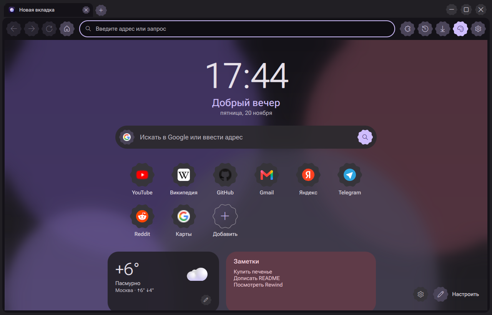
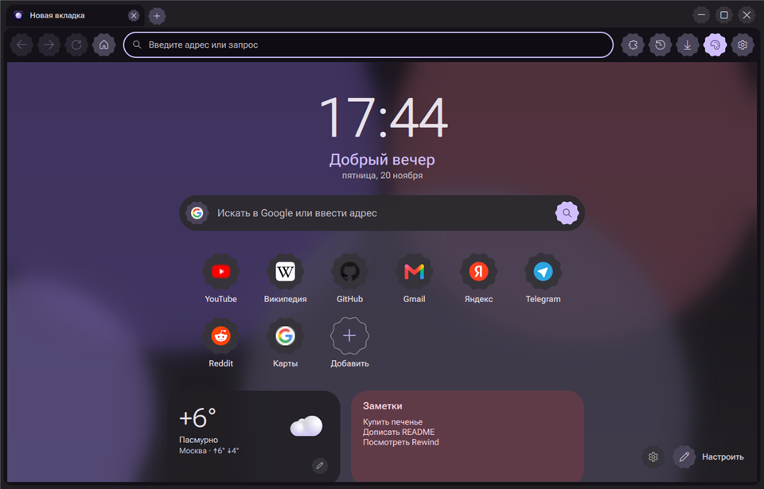
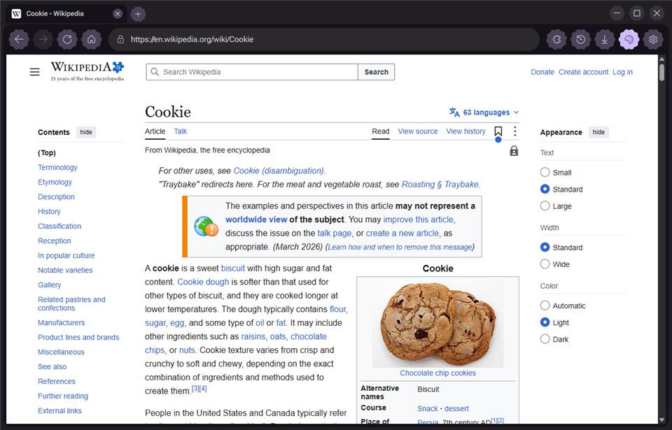
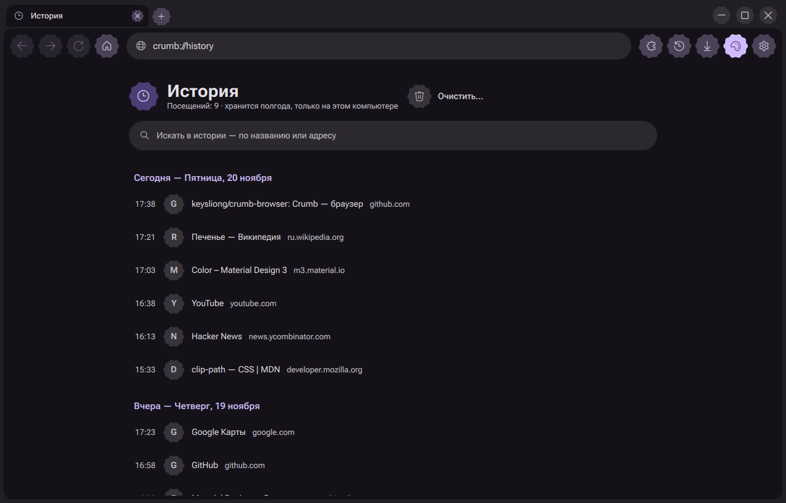
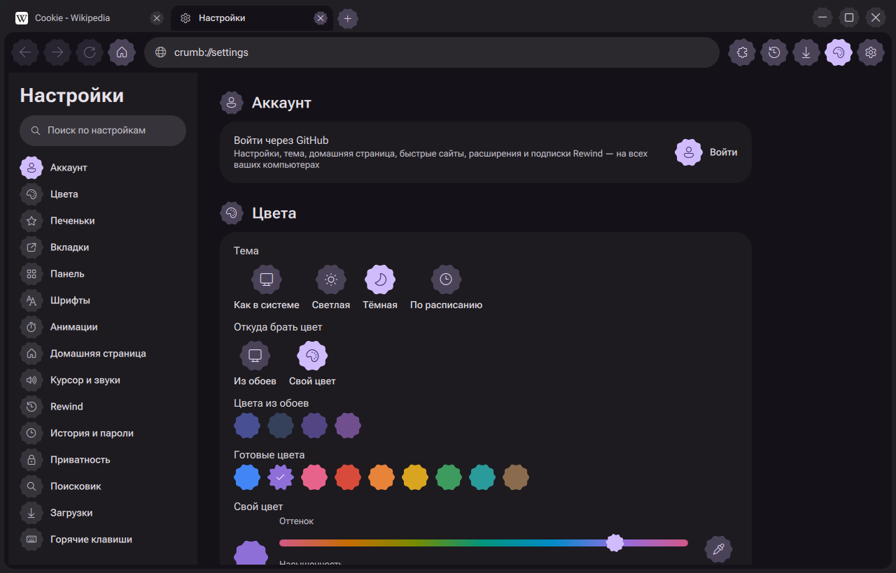

<div align="center">


# Crumb

**Браузер на базе Chromium в стиле Material You.**
Цвета из обоев, каждая кнопка — печенька, а страницы можно отмотать назад во времени.

[](https://github.com/keysliong/crumb-browser/releases/latest/download/Crumb-Setup.exe)
[](https://keysliong.github.io/crumb-browser/)




</div>

## Цвета, которые подстраиваются под вас

Палитра Material You строится из обоев Windows — или из любого цвета, который вы выберете.
Меняется всё сразу: вкладки, панель, страницы Crumb и даже тёмная тема сайтов.

<p align="center"></p>

## Что умеет

| | |
|---|---|
| ⏪ **Rewind** | Машина времени для страниц: как сайт выглядел вчера, что изменилось, слежка за фрагментом с уведомлением, поиск по всему, что вы видели |
| 🔑 **Свои пароли** | Предлагает сохранить пароль и подставляет его. Зашифровано Windows, показать — только после Windows Hello |
| 🕘 **История** | По дням, с поиском; подсказки прямо в адресной строке; недавно закрытые вкладки |
| 🗂 **Вкладки** | Сверху или сбоку, группы с цветами, всё возвращается после перезапуска |
| 🔍 **Поиск по странице** | `Ctrl+F`, «3 из 17», `F3`, учёт регистра |
| 🧩 **Расширения** | Из Chrome Web Store, с закреплением на панели |
| ☁️ **Аккаунт** | Настройки, домашняя страница и расширения на всех компьютерах — через ваш GitHub, зашифровано вашим паролем |
| ⬇️ **Загрузки** | Маленькое окно под кнопкой: прогресс, «Открыть файл», значки файлов из Windows |
| 🍪 **Печеньки** | Каждая кнопка крутится и пружинит; форму, анимации и звук можно настроить |

<p align="center"></p>

<table>
<tr>
<td></td>
<td></td>
</tr>
<tr>
<td align="center">История</td>
<td align="center">Настройки — всё видно сразу</td>
</tr>
</table>

## Установка

1. Скачайте [**Crumb-Setup.exe**](https://github.com/keysliong/crumb-browser/releases/latest/download/Crumb-Setup.exe).
2. Запустите и нажмите «Установить» — права администратора не нужны.
3. Готово. Обновление ставится поверх и сохраняет все настройки.

Установщик пока не подписан: если Windows SmartScreen предупредит, нажмите «Подробнее» → «Выполнить в любом случае».

---

## Сборка из исходников

Crumb написан на C++20: движок — CEF (Chromium, Chrome style), интерфейс — Qt 6 QML.

### Что нужно

| Компонент | Версия | Откуда |
|---|---|---|
| Visual Studio 2022 (или Build Tools) | 17.x, нагрузка «Разработка классических приложений на C++», Windows 11 SDK | `winget install Microsoft.VisualStudio.2022.BuildTools` |
| CMake | ≥ 3.24 (идёт в составе VS) | — |
| Qt | 6.10.3, `msvc2022_64`, модули qtmultimedia, qtshadertools, qtimageformats | скрипт ниже или Qt Online Installer |
| CEF | 156.0.31 (Chromium 156), Windows 64-bit, minimal | скрипт ниже или https://cef-builds.spotifycdn.com/index.html |

#### Установка Visual Studio Build Tools

```powershell
winget install --id Microsoft.VisualStudio.2022.BuildTools --override "--quiet --wait --norestart --add Microsoft.VisualStudio.Workload.VCTools --add Microsoft.VisualStudio.Component.Windows11SDK.26100 --add Microsoft.VisualStudio.Component.VC.CMake.Project --includeRecommended"
```

#### CEF и Qt одной командой

```powershell
powershell -ExecutionPolicy Bypass -File scripts\setup-deps.ps1
```

Скрипт кладёт CEF в `third_party\cef` (с проверкой SHA-1) и ставит Qt в `C:\Qt\6.10.3\msvc2022_64`.

Если удобнее руками:
- **CEF** — на https://cef-builds.spotifycdn.com/index.html выберите *Windows 64-bit → Stable → Minimal Distribution*,
  распакуйте и переименуйте папку в `third_party\cef`.
- **Qt** — в Qt Online Installer отметьте *Qt 6.10.x → MSVC 2022 64-bit* и модули *Qt Multimedia*, *Qt Shader Tools*,
  *Qt Image Formats*. Если путь не `C:\Qt\6.10.3\msvc2022_64`, поправьте `CMAKE_PREFIX_PATH` в `CMakePresets.json`.

### Сборка

Из «Developer PowerShell for VS 2022» (или любой консоли — cmake из комплекта VS сам найдёт компилятор):

```powershell
cmake --preset vs2022
cmake --build --preset release --parallel
```

Готовый браузер: `build\out\Release\Crumb.exe` (рядом — `crumb_helper.exe`, файлы CEF и Qt).

#### Иконка

SVG-варианты и их генератор — `resources/icons` (`gen_icons.py`, сравнение — `preview.html`).
Пересобрать `.ico`/`.png` из выбранного варианта (a…g; по умолчанию f — глобус-печенька):

```powershell
cmake -DCRUMB_ICON_VARIANT=f build
cmake --build --preset release --target icons
```

#### Настройки и данные

Настройки хранятся в SQLite: `%LOCALAPPDATA%\Crumb\crumb.db` (таблица `settings`), профиль Chromium —
`%LOCALAPPDATA%\Crumb\User Data`. Экспорт/импорт и «Сбросить всё» — на странице настроек (`crumb://settings`).

#### Установщик и удалятор

```powershell
cmake --build --preset release --target installer
```

Результат — `build\dist\Crumb-Setup.exe` и `build\dist\Crumb-Uninstall.exe` (один и тот же файл; режим
удаления включается именем файла или ключом `--uninstall`, как в образце Notepad You).

- Ставит для текущего пользователя в `%LOCALAPPDATA%\Programs\Crumb`, права администратора не нужны.
- Ярлыки на рабочем столе и в «Пуске» (+ «Удалить Crumb»), запись в «Установленных приложениях».
- Внутри — сжатая LZMS папка сборки (Compression API Windows, без сторонних библиотек). Маленький стартовый
  exe распаковывает во временную папку только интерфейс установщика (Qt), остальное ставится с прогрессом.
- Удалятор стирает только файлы из `install.manifest`; профиль браузера — только по отдельному переключателю.
- Диагностика: переменная окружения `CRUMB_SETUP_LOG=<файл>` — журнал интерфейса установщика.

В Visual Studio: *Файл → Открыть → Папка…* → корень проекта; VS подхватит `CMakePresets.json`.

### Почему так

- **Генератор Visual Studio, а не Ninja.** CMake-скрипты CEF при Ninja обнуляют глобальные `CMAKE_CXX_FLAGS`.
- **Только Release / RelWithDebInfo.** В minimal-дистрибутиве CEF нет отладочного `libcef.dll`.
- **Песочница Chromium выключена.** В CEF 156 песочница на Windows требует, чтобы приложение было DLL,
  загружаемой `bootstrap.exe`, — с Qt-приложением это несовместимо.
- **Обёртка CEF собирается с `/MD`**, как и Qt (по умолчанию CEF использует `/MT`).
- **Отдельный `crumb_helper.exe`** для процессов рендерера/GPU/сети — без Qt, стартует быстрее.
- **Chrome style + оконный режим.** Страница — дочернее окно Win32 поверх окна Qt. QML не может рисовать поверх
  страницы, поэтому всплывающие элементы Crumb — отдельные окна (`popupType: Popup.Window`) или панели рядом со страницей.

### Структура

```
CMakeLists.txt, CMakePresets.json
scripts/setup-deps.ps1        загрузка CEF и Qt
resources/crumb.manifest      совместимость с Windows 10/11, PerMonitorV2 DPI
src/main.cpp                  запуск Qt + CEF, порядок выхода
src/cef/                      всё, что общается с Chromium
  CrumbCefApp                 CefApp основного процесса
  BrowserClient               колбэки одной вкладки → в поток Qt
  CefRuntime                  инициализация/выход CEF, QML-синглтон
src/ui/
  BrowserView                 QML-элемент с окном браузера внутри
  UrlUtil                     адрес или поисковый запрос
src/helper/helper_main.cpp    crumb_helper.exe
qml/                          интерфейс браузера
  Main.qml                    окно без рамки, вкладки и группы, горячие клавиши
  TabItem.qml, AddressBar.qml, ThemePopup.qml
ui/                           общий модуль Crumb.Ui (браузер + установщик)
  src/MaterialColor.*         порт Material Color Utilities: CAM16/HCT, палитры, цвет из обоев
  src/Theme.*                 тема Material You (QML-синглтон Theme), WindowEffects
  qml/CookieButton.qml        единственная кнопка Crumb
  qml/CookieShape.qml, CookieSwitch.qml, ThemedMenu*.qml
  fonts/RobotoFlex.ttf        шрифт интерфейса (OFL)
installer/
  common/Payload.h            формат архива установщика
  stub/                       Crumb-Setup.exe (без Qt)
  pack/                       упаковщик
  setup/                      интерфейс установщика/удалятора (QML)
cmake/TrimQtDeploy.cmake      убирает лишнее после windeployqt
```

### Кодеки AAC / H.264 (Яндекс Музыка, видео в X и т.п.)

Официальные сборки CEF идут без проприетарных кодеков, поэтому сайты со звуком в AAC
(Яндекс Музыка) запускают трек и сразу останавливаются. Два способа:

```powershell
# быстро: сторонняя сборка CEF 149 с кодеками (проверка SHA-256)
powershell -ExecutionPolicy Bypass -File scripts\setup-codecs.ps1
# долго, но без чужих бинарников: собрать CEF из исходников (~10 ч, ~90 ГБ)
powershell -ExecutionPolicy Bypass -File scripts\build-cef-codecs.ps1
```

Если папка `third_party\cef-codecs` есть, CMake берёт её автоматически
(для уже настроенной папки сборки: `cmake -DCEF_ROOT=third_party/cef-codecs build`).
Распространять сборку с H.264 без патентной лицензии нельзя — только для себя.

### Аккаунт и синхронизация

Вход через GitHub (Device Flow), данные — в секретном Gist пользователя,
зашифрованы AES-256-GCM паролем синхронизации (PBKDF2-SHA256, 200 000 итераций).
Синхронизируются настройки, тема, домашняя страница, быстрые сайты, список расширений
и подписки Rewind. Нужен Client ID OAuth-приложения GitHub с включённым Device Flow:

```powershell
cmake -DCRUMB_GITHUB_CLIENT_ID=Ov23li... build
```

или вставить его в «Настройки → Аккаунт».

### Rewind

Машина времени для страниц: снимок после каждой загрузки (без страниц с паролями и
сайтов из чёрного списка), «что изменилось», подписки на фрагменты страниц с
уведомлениями и поиск по всему, что вы видели. `Ctrl+Shift+Y`. Всё хранится локально
в `%LOCALAPPDATA%\Crumb\rewind.db`.

### История, пароли, вкладки, поиск

Всё своё, без встроенных окон Chromium:

- **История** — `crumb://history` или `Ctrl+H`: посещения по дням, поиск, удаление за час/день/неделю/всё,
  недавно закрытые вкладки. Подсказки в адресной строке берутся из неё. Хранится полгода в
  `%LOCALAPPDATA%\Crumb\history.db`.
- **Пароли** — после входа на сайт Crumb предлагает сохранить пароль; при нажатии в поле логина
  показывает список сохранённых входов. Менеджер — `crumb://passwords`: поиск, добавление, генератор,
  изменение. Пароли зашифрованы DPAPI (`%LOCALAPPDATA%\Crumb\passwords.db`), показать или скопировать
  их можно после Windows Hello (или пароля Windows). Встроенный менеджер паролей Chromium выключен.
- **Восстановление вкладок** — вкладки и группы сохраняются через полторы секунды после изменения и
  возвращаются при запуске (в том числе после сбоя). Сайты в восстановленных вкладках загружаются,
  только когда вкладку открывают. Отключается в настройках: «Вкладки → При запуске».
- **Поиск по странице** — `Ctrl+F`, `F3` / `Shift+F3`, учёт регистра, «3 из 17».
